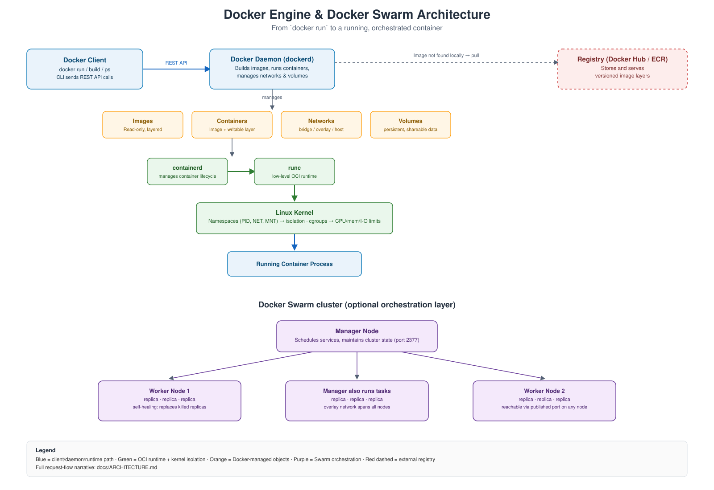

# Docker Zero to Production

<p align="center">
  
</p>

<p align="center">
  <a href="https://github.com/jeevanm84"></a>
  
  
</p>

## What this repository solves

Before containerization, an application's dependencies — the exact Java version Jenkins needs, the Python version the AWS CLI needs, a matching Tomcat build — had to be installed and kept in sync on every machine that ran it. Any drift between environments caused "works on my machine" failures that had nothing to do with the application code.

This repository is a hands-on, end-to-end study of Docker that fixes that problem, from first principles through a real CI/CD pipeline:

- **Docker Engine** — packages an application and its exact dependencies into one portable image, and runs it in an isolated process using Linux namespaces and cgroups — no second kernel, no VM overhead.
- **Docker Compose** — defines and runs a multi-container application from one YAML file on a single host.
- **Docker Swarm** — turns a group of Docker hosts into one cluster, adding replication, self-healing, rolling updates, and high availability.
- **Jenkins + Docker Hub** — a parameterized pipeline that builds, tags, pushes, and deploys a multi-service application to a live Swarm cluster.

## Who this is for and what you'll build

You'll come away able to explain, diagram, and reproduce:

- Why a container isn't a lightweight VM, and how namespaces + cgroups actually provide isolation and resource limits
- How to write, build, and optimize a Dockerfile — including the RUN vs. CMD vs. ENTRYPOINT distinction that comes up in almost every Docker interview
- How image layers, the Union File System, and build caching combine to make rebuilds fast (or accidentally slow)
- How to persist and share data with volumes, and connect containers with the right network driver for the job
- How to take a single-host Compose application to a self-healing, horizontally-scaled Docker Swarm cluster
- How to wire a real Jenkins pipeline that builds a chosen microservice's image, pushes it to Docker Hub, and deploys the whole stack with `docker stack deploy`

**Can it run locally without a cloud account?** Mostly. Everything through Compose (Tiers 1–2) runs on one Docker host — a laptop with Docker Desktop, or a single free-tier EC2 instance. The Swarm and Jenkins labs (Tier 3) need 3 small Linux hosts; each lab states that upfront.

**Where is the single end-to-end guide?** [`docs/END_TO_END_GUIDE.md`](docs/END_TO_END_GUIDE.md).

## Architecture

The diagram at the top of this README shows the full path from `docker run` to a running container — client → daemon → `containerd` → `runc` → the Linux kernel's namespaces and cgroups — plus how that same daemon, running on multiple hosts, becomes a Docker Swarm cluster with a manager and worker nodes.

Full write-up, request-flow narrative, and the monolith-vs-microservices framing (Amazon's services, an HDFC-style bank): [`docs/ARCHITECTURE.md`](docs/ARCHITECTURE.md).

## Learning path

Three tiers, in order. Don't skip a tier — each one assumes you can already do everything in the tier before it.

### Beginner — no cloud account, no cost

**You need:** comfortable with a terminal; no prior container knowledge required.
**You'll come out able to:** explain physical vs. VM vs. container, write a working Dockerfile, and correctly answer the CMD-vs-ENTRYPOINT question.

| Step | Do this |
|---|---|
| 1 | Read [`docs/ARCHITECTURE.md`](docs/ARCHITECTURE.md) — physical/VM/container, the dependency problem, Docker's request path |
| 2 | Study [`diagrams/docker-architecture.svg`](diagrams/docker-architecture.svg) until you can redraw the client → daemon → containerd → runc → kernel chain |
| 3 | Read [`docs/DOCKERFILE_REFERENCE.md`](docs/DOCKERFILE_REFERENCE.md) alongside the examples in [`examples/dockerfiles/`](examples/dockerfiles/) |
| 4 | Do [`labs/01-container-fundamentals.md`](labs/01-container-fundamentals.md) and [`labs/02-dockerfile-build-and-optimize.md`](labs/02-dockerfile-build-and-optimize.md) |
| 5 | Answer the Fundamentals and Dockerfile sections of [`docs/INTERVIEW_QUESTIONS.md`](docs/INTERVIEW_QUESTIONS.md) from memory |

### Intermediate — one Docker host

**You need:** a single Linux host with Docker installed (a free-tier EC2 instance or Docker Desktop is enough).
**You'll come out able to:** persist data correctly across container restarts, get containers talking to each other by name, and replace a pile of manual `docker run` commands with one Compose file.

| Step | Do this |
|---|---|
| 1 | [`labs/03-volumes-and-persistence.md`](labs/03-volumes-and-persistence.md) — named volumes, bind mounts, tmpfs |
| 2 | [`labs/04-networking.md`](labs/04-networking.md) — default bridge vs. user-defined bridge, DNS by container name |
| 3 | [`labs/05-compose-multi-service-bank-app.md`](labs/05-compose-multi-service-bank-app.md) — a 4-module app as one Compose stack |
| 4 | Read [`docs/STORAGE_AND_NETWORKING.md`](docs/STORAGE_AND_NETWORKING.md) and [`docs/COMPOSE_AND_SWARM.md`](docs/COMPOSE_AND_SWARM.md) in full |
| 5 | Answer the Storage & Networking and Compose & Swarm sections of [`docs/INTERVIEW_QUESTIONS.md`](docs/INTERVIEW_QUESTIONS.md) |

### Advanced — a 3-node cluster, production reasoning

**You need:** 3 Linux hosts that can reach each other (3 small EC2 instances is the cheapest path), plus a Docker Hub account.
**You'll come out able to:** run a self-healing, horizontally-scaled service across a cluster, and ship a change through a real parameterized CI/CD pipeline.

| Step | Do this |
|---|---|
| 1 | [`labs/06-swarm-ha-cluster.md`](labs/06-swarm-ha-cluster.md) — bootstrap Swarm, scale, kill a replica and watch self-healing, rolling update + rollback |
| 2 | [`labs/07-jenkins-image-pipeline.md`](labs/07-jenkins-image-pipeline.md) — parameterized Jenkins pipeline: build → tag → push → `docker stack deploy` |
| 3 | Read [`docs/CI_CD_PIPELINE.md`](docs/CI_CD_PIPELINE.md) and [`docs/SECURITY.md`](docs/SECURITY.md) in full, and check your deployed stack against the security checklist |
| 4 | Work every scenario in [`docs/TROUBLESHOOTING.md`](docs/TROUBLESHOOTING.md) — try to reproduce a few before reading the fix |
| 5 | Answer the Security and Architect/SRE sections of [`docs/INTERVIEW_QUESTIONS.md`](docs/INTERVIEW_QUESTIONS.md) without re-reading the docs first |

**Full walkthrough of all three tiers as one continuous path:** [`docs/END_TO_END_GUIDE.md`](docs/END_TO_END_GUIDE.md).

## Quick local verification

No cloud account needed to check the repository itself, or build every example image, locally:

```bash
git clone https://github.com/jeevanm84/docker-zero-to-production.git
cd docker-zero-to-production
python3 scripts/check.py

docker build -t basic-apache-site examples/dockerfiles/basic-apache-site
docker build -t entrypoint-cmd-demo examples/dockerfiles/entrypoint-cmd-demo
docker build -t flask-app examples/dockerfiles/flask-app
docker build -t nginx-load-balancer examples/dockerfiles/nginx-load-balancer
docker build -t multi-stage-maven-tomcat examples/dockerfiles/multi-stage-maven-tomcat

docker compose -f examples/compose/hdfc-bank-modules/docker-compose.yml config
docker compose -f examples/compose/flask-nginx-lb/docker-compose.yml config
docker compose -f examples/compose/swarm-stack-with-secrets/docker-compose.yml config
```

This validates Markdown structure and local links, confirms every example Dockerfile actually builds, and confirms every Compose file parses.

## Repository map

```text
docker-zero-to-production/
├── README.md
├── diagrams/
│   └── docker-architecture.svg  — client → daemon → containerd → runc → kernel, plus Swarm cluster
├── docs/
│   ├── ARCHITECTURE.md          — physical/VM/container, monolith vs. microservices, Docker's request path, OCI
│   ├── DOCKERFILE_REFERENCE.md  — every instruction, RUN/CMD/ENTRYPOINT, layers, caching, multi-stage builds
│   ├── STORAGE_AND_NETWORKING.md— volumes, the 5 network drivers, resource limits
│   ├── COMPOSE_AND_SWARM.md     — Compose YAML, Swarm cluster ops, services, secrets
│   ├── SECURITY.md              — least privilege, non-root, capabilities, image scanning, secrets
│   ├── CI_CD_PIPELINE.md        — the Jenkins parameterized build → tag → push → Swarm deploy pipeline
│   ├── TROUBLESHOOTING.md       — incident-style scenarios and root causes
│   ├── INTERVIEW_QUESTIONS.md   — fundamentals through architect/SRE level
│   ├── CODE_STRUCTURE.md        — what lives where and why
│   ├── END_TO_END_GUIDE.md      — single guided path through the whole repo
│   └── ROADMAP.md               — where this fits in the wider portfolio
├── labs/                        — 7 hands-on, numbered labs (fundamentals → Jenkins pipeline)
├── examples/
│   ├── dockerfiles/             — one concept per directory, each independently buildable
│   ├── compose/                 — 3 runnable multi-service Compose stacks
│   └── jenkins/                 — Jenkinsfile + stack file backing docs/CI_CD_PIPELINE.md
├── scripts/check.py             — Markdown/link/identity validation
└── .github/                     — CI, issue templates, PR template, CODEOWNERS
```

## Design decisions and trade-offs

- **No auto-deploy on push.** The Jenkins pipeline in `examples/jenkins/` is parameterized and manually triggered by design — an unreviewed push auto-rebuilding and redeploying the whole Swarm cluster is a real production risk, not a convenience worth the trade. See [`docs/CI_CD_PIPELINE.md`](docs/CI_CD_PIPELINE.md).
- **Swarm, not Kubernetes, for the orchestration labs.** Swarm is dramatically simpler to stand up for a 3-node cluster and teaches the same core orchestration concepts (services, replicas, rolling updates, self-healing) with far less setup. Its ceiling — no built-in autoscaling, simple round-robin load balancing — is documented explicitly in [`docs/COMPOSE_AND_SWARM.md`](docs/COMPOSE_AND_SWARM.md).
- **Compose examples use `build:` pointing at shared Dockerfiles** under `examples/dockerfiles/`, so each concept has exactly one source of truth instead of duplicated Dockerfiles per example.

## Security and cleanup boundaries

- Every example Dockerfile and Compose file is safe to build and run locally at no cost beyond compute time; the only real-cost labs are the 3-node Swarm cluster and Jenkins in Tier 3, and both state that upfront.
- Secrets are never embedded in an image or committed to source — the Swarm secrets example uses a `.gitignore`'d file with a checked-in `.example` template. Details: [`docs/SECURITY.md`](docs/SECURITY.md).
- No credentials, account IDs, or employer-specific data are committed — enforced by `scripts/check.py` and CI.

## Troubleshooting and interview links

- Incident-style scenarios (container exits immediately, cache invalidation surprises, Swarm self-healing behavior): [`docs/TROUBLESHOOTING.md`](docs/TROUBLESHOOTING.md)
- Interview question set with links back to the working evidence in this repository: [`docs/INTERVIEW_QUESTIONS.md`](docs/INTERVIEW_QUESTIONS.md)

## Roadmap position

This repository sits alongside the orchestration and CI/CD tracks in the [`jeevanm84`](https://github.com/jeevanm84) portfolio, extending into [`kubernetes-zero-to-production`](https://github.com/jeevanm84/kubernetes-zero-to-production) and [`cicd-gitops-platform-engineering`](https://github.com/jeevanm84/cicd-gitops-platform-engineering). See [`docs/ROADMAP.md`](docs/ROADMAP.md) for what's planned next.

## Contribution and support

- Issues are for reproducible defects or improvement proposals; use the templates under `.github/ISSUE_TEMPLATE/`.
- Discussions are for learning questions.
- See [`CONTRIBUTING.md`](CONTRIBUTING.md) and [`SECURITY.md`](SECURITY.md) before opening a pull request.
